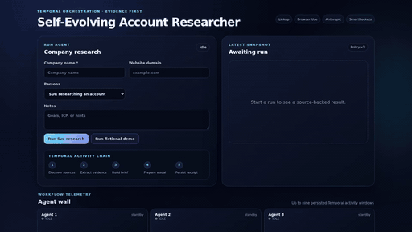

# Self-Evolving Account Researcher

A Temporal-orchestrated research workflow with a browser Agent Wall, persisted
evidence, and an explicit provider-free demo. The demo is intentionally fictional:
it runs the same workflow and storage activities as live mode, but every provider
boundary is bypassed by deterministic checked-in data.

## What is real in the demo

- a real local Temporal server and separately running worker/API processes;
- the full discovery → extraction → brief → visual → persistence activity chain;
- three fictional `.invalid` evidence pages, Agent Wall state, snapshot, and metrics;
- an immutable `POST /api/demo` entry point and visible fixture labels;
- zero Linkup, Browser Use, Anthropic, Freepik, or SmartBuckets requests.

The fixture does **not** demonstrate live company research, provider quality,
outreach delivery, or production performance. `POST /api/run_research` remains the
live path and rejects fixture-mode payloads; provider credentials and a working
Temporal service are required for a meaningful live run.

## Actual workflow demo



[Watch the 960×540 MP4](docs/demo/fixture-workflow.mp4) ·
[inspect the capture receipt](docs/demo/capture.json)

This 21-second sequence was generated from actual Chromium frames after the real
Temporal, worker, and API E2E completed at source commit `f140c2d`. It shows the
immutable fixture, persisted Agent Wall results, evidence, outreach preview, and
local visual. The media verifier pins every runtime input and fully decodes both
published formats.

## Run locally

```bash
cp .env.example .env
docker compose up --build
```

Open <http://localhost:8000>. “Run fictional demo” is safe and offline after the
containers are installed. “Run live research” may call configured providers.

Services include PostgreSQL, Temporal, Temporal UI, FastAPI, and a Temporal worker.
The API and worker share the configured `DATA_DIR` for snapshots, metrics, and
Agent Wall state.

## Verification

Install Python and Node dependencies from this directory:

```bash
python -m venv .venv
.venv/bin/pip install -r requirements.txt pytest
npm ci
```

Run the unit/regression suite:

```bash
.venv/bin/python -m pytest -q
```

Run the fixture through a real Temporal development server:

```bash
TEMPORAL_CLI=/path/to/temporal .venv/bin/python -m scripts.check_temporal
```

Run the separate-process Temporal + worker + API + Chromium E2E, including a
stored-DOM-injection regression:

```bash
TEMPORAL_CLI=/path/to/temporal \
PLAYWRIGHT_CHROMIUM_EXECUTABLE_PATH=/path/to/chromium \
npm run test:browser
```

Verify the checked-in media and captured source inputs:

```bash
.venv/bin/python scripts/verify_demo_media.py
```

The E2E deliberately sets provider-looking credentials and points their endpoints
at a closed local port. Completion proves the fixture path did not cross those
provider boundaries. The browser renderer uses DOM text nodes and permits only
HTTP(S) links; it no longer inserts API values through `innerHTML`.

## API

- `POST /api/demo` starts the immutable fictional fixture.
- `POST /api/run_research` starts live mode with `name`, optional `domain`,
  `persona`, and `notes`.
- `GET /api/run_status?workflow_id=…` reports workflow state.
- `GET /api/run/{workflow_id}/windows` returns validated Agent Wall state.
- `GET /api/snapshot/{snapshot_id}` and `GET /api/history` return persisted output.
- `POST /api/self_learn` runs the live provider-backed policy updater.

The application ships all visual CSS locally; it does not depend on a CDN to
render the interface.
